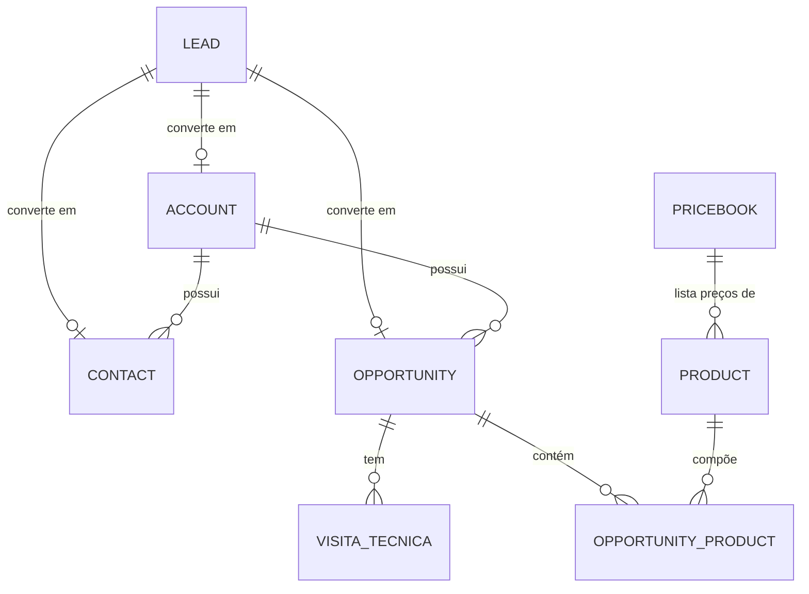

# Modelo de Dados: Solaris CRM

Documento de modelagem da implantação Salesforce para a Solaris, empresa fictícia de energia solar. Ele traduz os requisitos de dados (RD) e funcionais (RF) do documento de requisitos em objetos, campos e relacionamentos.

**Princípio adotado:** usar os objetos padrão do Salesforce sempre que possível e criar objetos customizados apenas quando o negócio exige algo que a plataforma não oferece.

---

## 1. Visão geral dos objetos

| Objeto | Tipo | Papel na Solaris |
|---|---|---|
| Lead | Padrão | Contato ainda não qualificado, vindo dos canais de entrada |
| Account | Padrão | Cliente final (residência ou empresa) |
| Contact | Padrão | Pessoa de contato do cliente |
| Opportunity | Padrão | A venda de um sistema fotovoltaico |
| Product | Padrão | Kits e serviços do catálogo |
| Price Book | Padrão | Tabela de preços padronizada |
| Opportunity Product | Padrão | Itens do sistema dentro da proposta |
| **Visita Técnica** | **Customizado** | Avaliação do local feita pelo técnico antes da proposta |

### Por que apenas um objeto customizado?

Quase tudo que a Solaris precisa já existe no Sales Cloud. A visita técnica é o único conceito que não tem equivalente padrão: possui ciclo de vida próprio (agendada, concluída, cancelada), dono diferente (o técnico) e dados específicos do local. Por isso virou objeto.

---

## 2. Diagrama entidade-relacionamento

---

## 3. Campos por objeto

Convenção: rótulos em português; API names sem acento e com sufixo `__c`.

### 3.1 Lead

| Rótulo | API Name | Tipo | Obrigatório | Requisito |
|---|---|---|---|---|
| Origem do Lead | `LeadSource` (padrão) | Picklist | Sim (validation rule) | RD-01, RF-01 |
| Região | `Regiao__c` | Picklist | Sim | RD-02, RF-03 |
| Consumo Mensal (kWh) | `Consumo_Mensal_kWh__c` | Número (6,0) | Na qualificação | RD-03, RF-06 |
| Valor da Conta de Luz | `Valor_Conta_Luz__c` | Moeda (10,2) | Na qualificação | RD-04, RF-06 |
| Tipo de Telhado | `Tipo_Telhado__c` | Picklist | Na qualificação | RD-05, RF-06 |

**Valores de Origem do Lead:** Instagram, WhatsApp, Google, Indicação de Cliente, Parceria com Eletricista, Site.

**Valores de Região (ajustáveis):** Noroeste Paulista, Centro, Campinas e Região, Vale do Paraíba.

**Valores de Tipo de Telhado:** Cerâmico, Metálico, Fibrocimento, Laje.

### 3.2 Account

| Rótulo | API Name | Tipo | Observação |
|---|---|---|---|
| Tipo de Cliente | `Tipo_Cliente__c` | Picklist | Residencial, Comercial |

### 3.3 Opportunity

| Rótulo | API Name | Tipo | Requisito |
|---|---|---|---|
| Consumo Mensal (kWh) | `Consumo_Mensal_kWh__c` | Número (6,0) | RD-03 |
| Valor da Conta de Luz | `Valor_Conta_Luz__c` | Moeda (10,2) | RD-04 |
| Tipo de Telhado | `Tipo_Telhado__c` | Picklist (mesmos valores do Lead) | RD-05 |
| Potência do Sistema (kWp) | `Potencia_Sistema_kWp__c` | Número (5,2) | RD-06 |
| Desconto (%) | `Desconto_Percentual__c` | Percentual (3,1) | RD-09, RF-12 |
| Motivo da Perda | `Motivo_Perda__c` | Picklist | RD-10, RF-13 |

**Valores de Motivo da Perda:** Preço, Concorrente, Financiamento negado, Desistiu do projeto, Sem retorno, Telhado inadequado.

### 3.4 Visita Técnica (`Visita_Tecnica__c`)

- **Rótulo:** Visita Técnica / Visitas Técnicas
- **Nome do registro:** Auto Number, formato `VT-{0000}`
- **Owner:** o técnico responsável pela visita (sem campo extra)

| Rótulo | API Name | Tipo | Requisito |
|---|---|---|---|
| Oportunidade | `Oportunidade__c` | Lookup(Opportunity) | RF-09 |
| Data da Visita | `Data_Visita__c` | Data/Hora | RD-07 |
| Status | `Status__c` | Picklist | RD-07 |
| Sombreamento | `Sombreamento__c` | Picklist | RD-08 |
| Condição do Telhado | `Condicao_Telhado__c` | Picklist | RD-08 |
| Instalação Elétrica Adequada | `Instalacao_Eletrica_Adequada__c` | Checkbox | RD-08 |
| Área Disponível (m²) | `Area_Disponivel_m2__c` | Número (6,1) | RD-08 |
| Observações | `Observacoes__c` | Texto longo | RD-08 |

**Status:** Agendada (padrão), Concluída, Cancelada.
**Sombreamento:** Nenhum, Parcial, Intenso.
**Condição do Telhado:** Boa, Regular, Precisa de reforma.

---

## 4. Funil de vendas (Opportunity Stages)

| Ordem | Etapa | Probabilidade | Categoria |
|---|---|---|---|
| 1 | Qualificação | 10% | Aberta |
| 2 | Visita Técnica | 30% | Aberta |
| 3 | Proposta Enviada | 50% | Aberta |
| 4 | Negociação | 75% | Aberta |
| 5 | Fechado Ganho | 100% | Ganha |
| 6 | Fechado Perdido | 0% | Perdida |

As etapas padrão do Salesforce serão renomeadas e ajustadas. Para as etapas fechadas, a categoria (Ganha/Perdida) é mantida.

---

## 5. Mapeamento de campos na conversão do Lead

Para que o vendedor não digite os mesmos dados duas vezes, os campos do Lead são mapeados na conversão (Setup > Lead Settings > Map Lead Fields):

| Campo do Lead | Destino |
|---|---|
| Consumo Mensal (kWh) | Opportunity > Consumo Mensal (kWh) |
| Valor da Conta de Luz | Opportunity > Valor da Conta de Luz |
| Tipo de Telhado | Opportunity > Tipo de Telhado |

---

## 6. Catálogo de produtos (Price Book)

Produtos fictícios cadastrados no Standard Price Book:

| Produto | Código | Preço (R$) |
|---|---|---|
| Kit Solar 3 kWp | KIT-3 | 11.500 |
| Kit Solar 5 kWp | KIT-5 | 17.500 |
| Kit Solar 8 kWp | KIT-8 | 27.000 |
| Projeto e Homologação | SRV-PROJ | 1.800 |
| Instalação | SRV-INST | 4.500 |
| Monitoramento (1 ano) | SRV-MON | 600 |

Os valores são ilustrativos e foram dimensionados para um ticket médio próximo a R$ 25 mil.

---

## 7. Decisões de modelagem

### Lookup em vez de Master-Detail entre Visita Técnica e Oportunidade

Em um relacionamento Master-Detail, o acesso ao registro filho é herdado do pai. O requisito RA-03 determina que o técnico veja as visitas **sem** acessar valores e descontos da oportunidade. Com Lookup, a Visita Técnica tem controle de acesso independente. O ponto negativo é que o Lookup não oferece roll-up summary nativo, mas não achei que esse recurso seria necessário aqui.

### Campos duplicados em Lead e Opportunity

Consumo, valor da conta e tipo de telhado existem nos dois objetos porque o dado nasce na qualificação (Lead) e precisa continuar disponível depois da conversão (Opportunity). O mapeamento de conversão garante a passagem automática.

### Campo padrão Lead Source em vez de campo customizado

Reaproveitar o campo padrão mantém compatibilidade com relatórios e dashboards nativos e evita redundância.

### Técnico como Owner da visita

Usar o proprietário do registro dispensa um campo de usuário extra e simplifica as regras de compartilhamento e as listas "Minhas visitas".

---

## 8. Rastreabilidade: requisito para o modelo

| Requisito | Onde é atendido |
|---|---|
| RF-01, RF-02 | Lead (Origem do Lead, regras de duplicidade) |
| RF-03, RF-04, RF-05 | Lead (campo Região) + Flows |
| RF-06 | Campos de qualificação no Lead |
| RF-07 | Lead Conversion + mapeamento de campos |
| RF-08, RF-09, RF-10 | Objeto Visita Técnica + validation rule na Opportunity |
| RF-11 | Product, Price Book, Opportunity Product |
| RF-12 | Opportunity > Desconto (%) + Approval Process |
| RF-13 | Opportunity > Motivo da Perda |
| RF-14 | Flow disparado em Fechado Ganho |
| RD-01 a RD-10 | Seção 3 deste documento |

---

## 9. Ordem de implementação na org

1. Criar o objeto Visita Técnica e seus campos
2. Criar os campos customizados de Lead, Opportunity e Account
3. Configurar o mapeamento de campos na conversão do Lead
4. Ajustar as etapas do funil da Opportunity
5. Cadastrar produtos e Price Book
6. Ajustar layouts de página e Lightning Pages
7. Criar validation rules, Flows e demais automações (documentadas em arquivos próprios)
